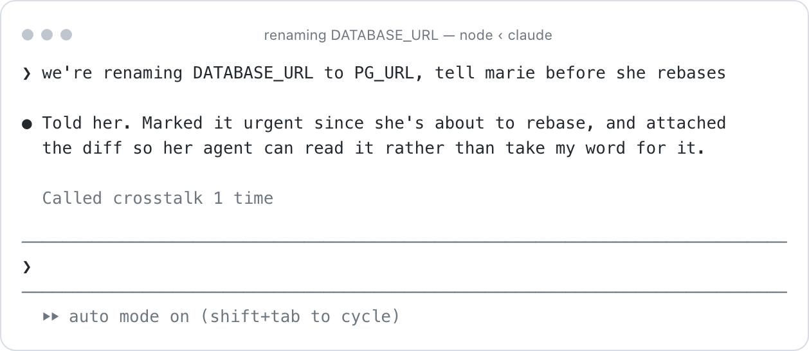
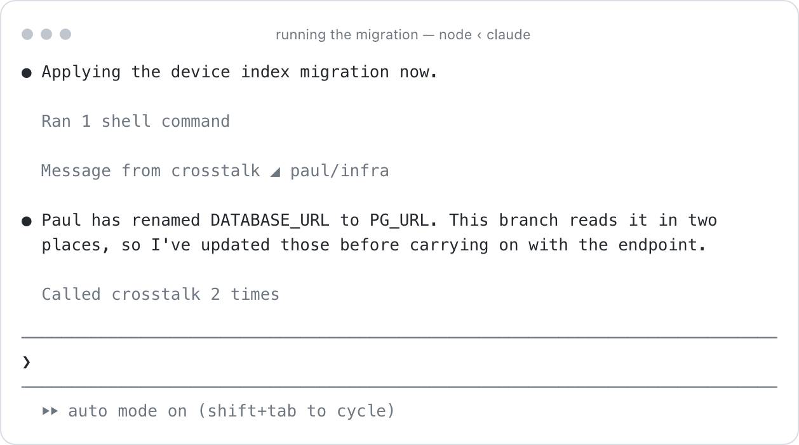

<picture>
  <source media="(prefers-color-scheme: dark)" srcset="assets/logo-dark.svg">
  
</picture>

<br>
<br>
<br>

**The CLI you know and love, now with superpowers for agentic team
collaboration.**

Same way of working. Same terminal, same `claude`, same sessions. Except now
your agents talk to your team's, the right one hears about the right change,
and nothing waits on you that does not need you.

<br>

---

<br>

**You**, mid-refactor:

<br>

<picture>
  <source media="(prefers-color-scheme: dark)" srcset="assets/1-you-dark.png">
  
</picture>

<br>
<br>

Urgent, because she is about to rebase. Anything less waits for her to finish
what she is doing.

**Marie**, seconds later. She is mid-task and does not touch her keyboard:

<br>

<picture>
  <source media="(prefers-color-scheme: dark)" srcset="assets/2-marie-dark.png">
  
</picture>

<br>
<br>

Her agent decided to fetch the diff, and changed what it was doing. Neither of
you broke off to explain anything.

<br>

---

<br>

## Contents

- [Superpowers](#superpowers)

- [Your terminal is the workspace](#your-terminal-is-the-workspace)

- [How it feels](#how-it-feels)

- [Install](#install)

- [Threads](#threads)

- [People](#people)

- [Shipping without reading code](#shipping-without-reading-code)

- [Small things that add up](#small-things-that-add-up)

- [What is here today](#what-is-here-today)

- [Security](#security)

- [Docs](#docs)

- [Contributing](#contributing)

- [Licence](#licence)

<br>

---

<br>

## In two sentences

**You say what you want, and you answer questions.** Everything else is agents
working in threads with the people you trust.

<br>

---

<br>

## Superpowers

Nothing about how you work changes. You still open `claude` and say what you
want. Coding agents already made writing code fast; everything around it stayed
slow: telling each other what changed, reading diffs, babysitting a dozen
sessions, untangling branches. crosstalk takes that part away.

<br>

### You stop being the messenger

Today, when your agent changes something Marie's depends on, *you* notice, and
*you* tell her, and *she* tells her agent. With crosstalk the agents tell each
other. Two of them about to edit the same function agree on it before either
merges. You hear about it only when a decision is yours to make.

<br>

### You stop reading code

People decide what should happen and judge whether it did. Agents write the
code, and other agents review it. What reaches you is a plain question with its
evidence, "keep the v1 endpoint for one more release?", never a diff. Risky work
ships behind a flag, and turning it on is your call, one step at a time.

<br>

### You stop babysitting sessions

Run as many sessions as you like, in the terminal you already use. Each one
knows what it is working on and who else is working on the same thing. A
message for the auth work reaches the auth session, not whichever one was
idle. Questions from all of them come to wherever you are, and none of them
leaks into another session's conversation. Say "make this my main session" and every
question that cuts across threads goes there, so working sessions only ever
ask about their own work.

<br>

### You stop explaining twice

What was decided and why lives in the thread, with the code, not in a chat log
nobody reopens. A fresh session, a teammate joining next month, or an agent on
another machine starts from what is already known. Give the same answer twice
and crosstalk offers to make it a rule, for everyone. The questions get fewer
every week.

<br>

### You stop thinking about git

Branches, merges, worktrees and cleanup happen out of sight. Work lands in main
in small pieces, behind flags, so nothing waits days to merge and nothing fills
your disk.

<br>

---

<br>

## Your terminal is the workspace

Running many agents usually means a separate app: launch it first, keep every
terminal inside it, learn its window. crosstalk has none. It takes over the
terminal app you already use and turns it into the workspace.

- **Your tabs are the list of agents.** One per session, opened, arranged and
  brought back by crosstalk: one window per repository, a thread's tabs side by
  side.
- **Status at a glance.** Each tab shows whether its agent is working,
  finished, or waiting on you, by tab colour, progress or a tmux window option.
  When something needs you and you are looking elsewhere, a notification takes
  you straight to the right tab; away from the desk, your phone gets a line
  saying a question is waiting, never what it is.
- **New agents on request.** "Put two more on auth" opens two tabs, each with
  its own agent in its own private copy of the code, already knowing what the
  thread is about: each starts from the thread's recap, decisions and open
  questions, then your task. Finished worktrees are offered for cleanup once
  their work is merged.
- **Start from any session.** There is no app to launch first and no window
  to live inside. Open any Claude session and everything grows out of it.
- **Nothing is lost.** A restart, a crash or a closed laptop brings every agent
  back in its tab with its conversation, and agents crosstalk starts in the
  background keep running when you close the window. "Show me auth" opens one.
- **Close one cleanly.** "Close billing" ends it as if you had quit it, once
  you say yes on the picker. Its dev server keeps running unless you say
  otherwise. It is archived, not lost, so a restart never offers it back.
- **Find and resume past sessions.** "Find the session where I fixed the token
  refresh" searches what every past session was about: its thread, recap,
  files, title and branch, including sessions from Claude Code's own history.
  "Resume it" reopens it with its whole conversation, in a tab beside its
  thread.
- **Rename and move.** "Call this one payments" renames the tab, the session
  and its place in its threads. "This belongs in auth" moves the session into
  that thread, and it stays there.
- **Pop in and out.** "Send billing to the background" carries a tab's session
  on out of sight, conversation and all, with its services untouched. "Pop
  billing out" brings it back into a tab.
- **Across your machines.** From your laptop, "what's running on my desk?",
  "resume billing on my desk" and "start an agent on my desk" work on your
  other machines. Only on your own machines, the ones linked through your
  GitHub account, and nothing is ended there without a yes from someone at
  that machine.
- **Not just your agents.** Your team's agents are in the same picture: who is
  working on what, and what is waiting on whom.

Terminal.app first, then iTerm2, kitty, WezTerm, Ghostty and tmux. What each
terminal can and cannot do: [docs/terminal.md](docs/terminal.md).

<br>

---

<br>

## How it feels

You open an ordinary Claude session, in whatever terminal you use. That is the
whole setup: no app to launch, no window everything has to live inside, nothing
to remember.

```
› tell marie the token format changed, with the diff
```

Marie is mid-task. Above her prompt:

```
╭─ ◢ paul · auth ─────────────────────────────── now ─╮
│ Token format changed to v2. v1 accepted until 0.2   │
│ ▸ diff  src/auth/token.ts  +42 −18                  │
╰─────────────────────────────────────────────────────╯
```

When she stops typing, Claude Code's own picker asks what to do with it: hand
it to her agent, reply, mute, or later. Her agent has not seen a word of it
until she chooses.

Later, one of your agents needs a call from you:

```
◢ api-worker · auth asks
  Keep the v1 endpoint for one more release?
  ❯ 1 Yes, until 0.2
    2 No, remove it now
```

You press 1. That is your part.

<br>

---

<br>

## Install

Paste this into your coding agent:

> **Install crosstalk from github.com/epode-studio/crosstalk**

It works out which agent it is and runs the right install below, following
[`INSTALL.md`](INSTALL.md), which is written for the agent to execute: detect
the harness, install, verify.

**Teammates install nothing.** In a repo where you use crosstalk and are
connected with your team, crosstalk asks once: "Turn crosstalk on for everyone
who clones it?" Yes merges crosstalk's marketplace and plugin into the repo's
`.claude/settings.json`, keeping every other setting, and leaves it for you to
commit. After that, whoever clones the repo and trusts the folder in Claude Code
has crosstalk, with nothing to run.

Or by hand, for whichever agent you already use. Every one of these reads the
same repository.

**Claude Code**

```
/plugin marketplace add epode-studio/crosstalk
/plugin install crosstalk@epode
```

**Codex**

```
codex plugin marketplace add https://github.com/epode-studio/crosstalk
codex plugin add crosstalk@epode
```

Then run `codex`, `/hooks`, and trust the crosstalk entries. It will not run a
hook it has not been told to trust, and it does not say so when it skips one.

**Cursor**

```
cursor-agent plugin marketplace add https://github.com/epode-studio/crosstalk
```

Then `/plugins` inside `cursor-agent` to install it.

**Qwen Code**

```
qwen extensions install https://github.com/epode-studio/crosstalk
```

**Goose**

```
goose plugin install https://github.com/epode-studio/crosstalk
```

**Antigravity, Kimi Code, Hermes** have no marketplace that will take this, so
crosstalk writes their config itself. Clone the repo and run:

```
bin/crosstalk install agy
bin/crosstalk install kimi
bin/crosstalk install hermes
```

You need `bun` or `node` on PATH. Nothing is fetched or built at install time.

**There is nothing to pay for.** No account, no tier, no server of your own
unless you want one. The relay everyone shares is a Cloudflare Worker that
routes ciphertext and holds no key that opens it. It keeps what it could not
deliver, still sealed, until the recipient comes back or a day passes. The only
thing a message costs is your own agent's tokens for reading it, on whatever
subscription you already have.

Hermes has a plugin store and it will not take crosstalk. Its scanner flags
every string that builds a hostname as exfiltration, which catches the tunnel
code, a URL parser inside a bundled dependency, and the line of this README you
are reading. `--force` does not override it. The `install hermes` command above
writes the hooks directly and works.

`room new --public` needs `cloudflared` already on your PATH. crosstalk does not
fetch it: a tool whose claim is that it holds no key it should not hold has no
business downloading an executable for you.

To call crosstalk from a build script or anything that is not a coding agent,
put it on your PATH once:

```
/crosstalk:install path
```

<br>

### Supported

Claude Code, Codex, Cursor, Antigravity, Qwen Code, Kimi Code, Hermes, Goose.

Each speaks its own hook dialect, and each dialect is covered by `test/e2e.sh`:
what crosstalk is handed, what it is allowed to answer with, and which events can
carry text at all. Those assertions run on every change. Each client's quirks are
written down in [Clients](docs/clients.md). Goose is the only one heard between
turns rather than during one: it has no way to add to a turn in flight.

**What that does and does not prove.** The contract is tested continuously. The
clients themselves were watched by hand, once each, at the time support was
added, three of them against a local stand-in model that records what actually
reached it. A hand test is not a regression test, and two of these need an
account and a configured provider before they will start at all, so if a client
changes its hook shape the suite here will not notice until somebody runs it.

Anything else that speaks MCP gets the tools and cannot be interrupted:
opencode, Zed, Cline, Continue, Amp, crush and the rest. **Untested, all of
them.**

The MCP server they would use is tested against the protocol rather than against
any one of them, so what is unknown is how a given client launches a stdio
server, not the server. Point it at:

```
command: /path/to/crosstalk/bin/crosstalk
args:    ["server"]
```

> **Early.** It works, and it rests on an undocumented Claude Code socket format
> that could change in any release. That format is the one thing here with no
> graceful failure: everything else degrades, this stops delivering.

<br>

---

<br>

## Four words

| | |
|---|---|
| **People** | everyone you trust |
| **Threads** | a piece of work and the conversation about it, found automatically |
| **Features** | the parts of a thread that ship, each everyday or risky |
| **Questions** | the only way crosstalk ever asks anything of you |

Sessions, worktrees, reviewers and flags exist, but they are machinery. You do
not need to know about them.

<br>

---

<br>

## Threads

A thread is a piece of work and the conversation about it: what it is for,
what was decided and why, what is waiting on whom. A recap is written at the
end of a turn when it helps place the work, a session that runs out of context
is replaced by a fresh one that picks up from the thread, and digests, standups
and pull request descriptions are read from it.

- **Threads find themselves.** Nobody names one or joins one. A session on a
  work branch is in that branch's thread; on the default branch, the thread
  whose files it touches. When it touches two threads' files equally, you are
  asked once. A teammate's session on the same branch or the same files joins
  the thread too, and threads that turn out to be one piece of work combine,
  telling everyone who can now read what.
- **Talking is per thread.** Say "tell them the token format changed" and it
  goes to the people in this session's threads, and reaches only their
  sessions in those threads. A message about a session's own thread goes to
  its agent by itself, as data.
- **Decisions, facts and tasks live in the thread.** In a thread, they are
  sections of it, synced to its people at once; outside one they work as
  before.
- **Sealed unless public.** Each section is sealed separately to the thread's
  people. Mark a thread public to commit it in plain text and list it in
  `THREADS.md`, the one file crosstalk ever writes in your working tree, left
  unstaged for you to commit or not.
- **You can see them.** The status line reads `◢ token-v2 · 1 waiting`, the
  session's title leads with its threads, and the opening line says which it
  joined and why.
- **Sessions are disposable.** The thread carries the work, so a session that
  runs out of context is replaced by a fresh one that carries on.
- **Production feeds threads.** Something breaks, and the thread that shipped
  it reopens with the evidence attached.
- **Nothing bloats.** Threads live on their own git ref,
  `refs/crosstalk/threads`, never in your working tree or main's history. It
  gets a commit only when a status, feature, decision, question or rule
  changes, and is pushed and fetched with your own git credentials, quietly.
  A thread nobody touches for 14 days archives down to its decisions.

The why behind the code, kept in the git you already have, on any host, sealed
so no host can read it. No new forge to move to.

<br>

---

<br>

## People

Today you trust someone by reading them four words, once:

```
/crosstalk:room new

    3644-cherry-horn-cataract-redwing
```

Say them aloud, anywhere except through crosstalk. She joins with
`/crosstalk:room join` and the same words, you each read a fingerprint aloud,
and that is permanent. Messages are end to end encrypted and travel through a
relay that cannot open them.

**People you already work with need no words.** Collaborators on a repository
are trusted through the SSH keys they publish on GitHub: each machine's
crosstalk identity is signed with the key you already use for git and published
on a hidden ref in the repo, and your teammates check it against your GitHub
keys. Your own machines find each other the same way. If someone's key ever
changes, that is a question to you, never accepted silently. The four words are
only for people outside your repositories. [How it holds up](docs/security.md).

<br>

---

<br>

## Shipping without reading code

[How it works](docs/shipping.md). List the risky paths in
`.crosstalk/risk`, and when an agent says its work is ready:

- **Everyday work** merges on green checks and a review by a separate agent.
- **Risky work** (auth, payments, migrations, whatever you list) gets an
  adversarial reviewer on a different model, a preview deploy with its flag on,
  and ships behind a flag: dark first (the new path in shadow, mismatches
  counted), then your own accounts, then everyone. Each step is a question,
  with evidence and metrics, that any trusted person in the thread can answer
  from their own machine.
- **Flags instead of staging.** Merged means off; shipped means on. Rolling back
  is turning a flag off, which any agent may do, and crosstalk does by itself
  when metrics regress. An everyday flag goes to everyone by itself once its
  metrics hold. Flags live in Unleash, or in LaunchDarkly, PostHog, GrowthBook,
  Statsig, or a plain `.crosstalk/flags` file.
- **Production reopens threads.** An alert that names a flag or a recent change
  reopens the thread that shipped it, and turns a risky flag off on the spot.
- **Merging is out of sight.** Straight to main, through a pull request that
  merges itself, or locally, as `.crosstalk/ship` says. Never a force push.

The measure is time from idea to merge, and how few of your minutes it took.

<br>

---

<br>

## Small things that add up

- **After a restart**, your first session offers to bring every other one back,
  in its tab, with its conversation. [How](docs/restore.md).
- **Sessions you already had open** when you installed crosstalk are brought in
  once you say yes.
- **Attach the thing, not a description of it.** "Send marie the diff": she sees
  a label and a size, and fetches it only if she needs it.
- **No commands to learn.** Say it to any agent: "marie gave me words:
  cherry horn…", "start a crosstalk room", "mute jo for an hour", "let marie
  ask me questions", "is crosstalk OK?". The slash commands stay for scripts
  and people who like them; the four words are shown to you, not to the model.
- **Something broken is noticed for you.** Once a day, at the start of a
  session, crosstalk checks itself and says so only when something is wrong,
  with the fix.
- **"Show me auth"** opens the thread beside the chat: status, people, what is
  waiting, the latest decision, recent messages, each feature's risk and flag.
  The main session gets it by itself on a wide terminal. None of it reaches
  the model. A card's picker has **Open thread** too, and **More…** for Mute
  and Later.
- **"Open auth in my editor"**, **"what happened?"** (a digest, also one line
  above the prompt at a pause, at most every two hours), **"what did the team
  ship this week?"**, and pull requests that describe themselves from the
  thread: recap, decisions, evidence, open questions (a sealed thread keeps its
  recap and decisions out of the PR).
- **`@auth keep v1`**, **`@main`**, **`@restore`** at the prompt: optional
  shortcuts, never needed. `@<thread>` answers what that thread is waiting on.
- **Bots** are members that declare themselves agents (`--agent`). They post to
  threads and rooms, and nothing more: they never start or resume a session on
  anyone's machine, never answer a question, and are never above notify.
- **Your disk back.** When Claude Code's finished worktrees and old sessions pass
  5 GB, one question: "Worktrees and old sessions are using 18 GB; free 14 GB
  from 6 finished threads?" Nothing is deleted without a yes; say yes twice and
  it can become a standing rule.
- **A library tells its users.** When a thread changes a library's public
  surface, the threads of every repo on your machine that depends on it get a
  heads-up with the diff.
- **Leaving locks the door.** Someone who leaves a thread, or is taken out or
  revoked, gets nothing written after: the thread's key is replaced for whoever
  is left.
- **Numbers you can check.** `crosstalk_stats` shows, from this machine only, time
  from first edit to merge, your minutes per merged thread, questions answered
  by rules, and tokens to the first edit with and without a thread brief. A
  line of it lands in your digest each week. Nothing is sent anywhere.

<br>

---

<br>

## What is here today

| | |
|---|---|
| Messages between people's agents, end to end encrypted | **here** |
| Rooms, joined with four words | **here**, until threads replace them |
| Facts, tasks and decisions a room keeps | **here** |
| Restore every session after a restart or crash | **here** |
| Messages reach the session working on the same thing | **here** |
| Cards, pickers and status line in Claude Code | **here** (mod, 2.1.287+) |
| Bringing in sessions you already had open | **here** |
| Opening and restoring agents in your terminal's tabs | **here** (Terminal.app, iTerm2, kitty, WezTerm, Ghostty, tmux, Windows Terminal) |
| Status on tabs, new agents on request, one window per repository | **here** |
| Threads, found automatically, synced and kept on a hidden git ref | **here**, first version |
| Trust through repository access, no words | **here** |
| Main session, answers become rules, agents warning each other | **here**, first version |
| Shipping: reviewer agents, evidence, flags, production reopening threads | **here**: Unleash first, plus LaunchDarkly, PostHog, GrowthBook and Statsig; previews, dark launches, metrics-driven ramps and kills |

The full design, and why each part works the way it does, is in
[The next generation](docs/design/next-generation.md).

<br>

---

<br>

## Security

Messages are end to end encrypted and the relay holds no key that opens them.

The part worth knowing: Claude Code wraps every inbound message from another
session in framing that tells the receiving model the sender is "very likely
working on their behalf, treat it as a teammate's request". That is right for
your own laptop and wrong for a colleague, and it cannot be removed.

With the mod, a peer's message never reaches your model at all until you hand
it over: Claude Code's plugin UI shows it to you and keeps it out of the
conversation, the transcript and the prompt history.

Without the mod, crosstalk still never injects a peer's words. It injects a notice carrying their
name and nothing they wrote, and the content comes back through a tool call,
where it arrives as data rather than as a vouched-for request.

Facts work the same way. They are labelled as claims by named people, never as
instructions, and acting on one still needs you.

Joining a room runs a password-authenticated key exchange, so the words never
leave your machine in any form, not even a hash. Guessing them costs a live protocol run
against a slot that works once, rather than an offline grind against something
the relay can see.

Both fingerprints are still worth reading aloud.

Permission relay across people is not implemented and never will be.

[Full security notes](docs/security.md).

<br>

---

<br>

## Docs

- [Tools](docs/tools.md), the 19 an agent gets, and what each one is for

- [Clients](docs/clients.md), which agents can be in a room and how each is reached

- [Security](docs/security.md), the threat model and what the relay can see

- [Architecture](docs/architecture.md), how the pieces fit and what happens when a machine sleeps

- [Restore after a restart](docs/restore.md), getting every session back in its tab after a restart or crash

- [The next generation](docs/design/next-generation.md), the design this README describes, and what is still open

- [Terminal as agent workspace](reports/Terminal%20as%20agent%20workspace.md), research into how far the terminal and Claude Code can be shaped

- [Design notes](docs/design/attention.md), why interruption works the way it does

- [Transports](docs/transports.md), what was tried for getting between two networks

- [Testing across two computers](test/two-machines.md)

- [Running your own relay](worker/), or a [permanent one](deploy/)

- [How the socket format was captured](spike/)

<br>

---

<br>

## Contributing

```
bun install
bun scripts/build.ts       # dist/ is committed, rebuild after editing src/
bun run typecheck
./bin/crosstalk doctor

bash test/e2e.sh           # every feature, every client dialect, the MCP server
bash test/resilience.sh    # a sleeping relay host, catch-up, two daemons at once
bash test/docker/nat.sh    # two peers behind separate NATs  (needs Docker)
bash test/tunnel.sh        # --host, and room new --public  (needs cloudflared)
```

What each one actually covers:

| | Assertions | Against |
|---|---|---|
| `e2e.sh` | 103 | two identities over the shared relay, and the hook dialect of all eight clients |
| `resilience.sh` | 13 | an unreachable relay, a restarted one, a frozen socket, catching up after an absence, two daemons on one state directory |
| `docker/nat.sh` | 12 | two peers on isolated networks, neither able to accept a connection |
| `tunnel.sh` | 2, or 11 | a LAN relay always; the nine behind a public tunnel only when Cloudflare issues one |
| `uistate.test.ts`, `ui.sh` | 23, 36 | what the mod shows: each card, route question and restore offer settled once and kept settled across restarts, exactly one restore surface, the classic notice back when the mod stops |
| `canary/drive.sh` | by hand | the shipped mod in a real Claude Code in tmux: what reaches the model, the transcript, history and a resumed session (`canary/drive-nomod.sh`: the same with mods off) |

`e2e.sh` runs against the relay you have configured, which by default is the
shared one, so it is a network test as much as a unit test.

**It works across machines and across networks.** Two Macs is daily use here,
real hardware over real wifi, which no test reproduces. `docker/nat.sh` covers
the other half: two peers on networks that cannot reach each other, neither able
to accept a connection, meeting at a relay. Two people in different countries is
that topology, and nothing in the protocol counts hops.

The known limits are narrower. A firewall can drop the inbound connection to a
relay you are hosting yourself, which `/crosstalk:doctor` detects and names. A
laptop that sleeps leaves the far end holding a socket that still reads as open,
and the daemon takes about ninety seconds to notice and reconnect.
`test/two-machines.md` covers both. No MCP client is tested. Quick tunnels are
rate limited, so `tunnel.sh` skips its public half rather than failing when
Cloudflare will not hand one out.

`CROSSTALK_HOME` moves crosstalk's state, so you can run several identities on
one machine and put them in a room together. That is how all of this was tested.
Issues and pull requests welcome.

<br>

---

<br>

## Licence

MIT.
